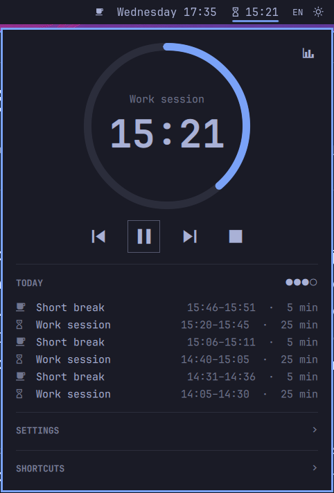
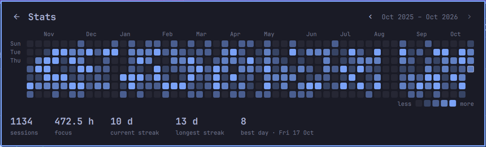

# Pomarchy: a Pomodoro timer for Omarchy

[](https://github.com/nambrosini/pomarchy/actions/workflows/ci.yml)

**Pomarchy** is a Pomodoro timer plugin for the [Omarchy](https://omarchy.org) bar, the Quickshell bar on Omarchy's Hyprland desktop. Work sessions and breaks count down in the bar, a popup holds the controls, and a GitHub-style graph shows your focus history. When a phase ends you hear a sound and get a notification, and **the next phase only starts once you confirm it**.

<p align="center">
  
</p>

## Features

- Countdown in the bar; the widget pulses in the urgent colour while a phase change waits for you
- Popup with a progress ring and audio-player controls: back, play/pause, next, stop
- Today's finished sessions and progress toward the long break (`●●○○`)
- Stats: a year of work sessions as a GitHub-style contribution graph, with streaks and focus hours
- Settings from the popup: durations and sessions before a long break, saved to `shell.json`
- Sound and a sticky notification you can click to start the next phase
- Survives shell restarts and reboots without drifting
- Keyboard shortcuts in the popup, and IPC commands for keybindings and scripts

## Install

```bash
omarchy plugin add https://github.com/nambrosini/pomarchy --enable
omarchy bar move nambrosini.pomarchy --after omarchy.clock    # place it after the clock
```

To work on it from a checkout:

```bash
git clone https://github.com/nambrosini/pomarchy.git
ln -s "$PWD/pomarchy" ~/.config/omarchy/plugins/nambrosini.pomarchy
omarchy plugin enable nambrosini.pomarchy
```

## Usage

Click the widget to open the popup; click it again or press `Esc` to close it. Hovering shows the phase, time left and cycle progress.

| Control | Key | Action |
|---|---|---|
| Back | `h` / `←` | More than 5 s into a phase: restart it. Otherwise go to the previous phase (redoing a work session takes its count back) |
| Play / pause | `Space` / `Enter` | Start, pause or resume. While waiting, start the next phase |
| Next | `l` / `→` | End the phase now (it counts). While waiting, start the next phase; a pending break is skipped in favour of work |
| Stop | `s` | Back to idle. The stopped phase doesn't count; cycle progress and today's sessions stay |
| Stats (chart icon) | `g` | Open the stats; `Esc` or ← goes back |

The cycle is work → short break → work …, with a long break after every 4th work session. When a phase ends, a sound plays, a notification stays on screen until you click it, and the bar shows a pulsing `Break?` or `Work?`. The next phase starts when you click the notification, press play, or run `omarchy-shell pomarchy confirm`. Do Not Disturb hides the notification, but the bar keeps asking.

### Stats

<p align="center">
  
</p>

One square per day for the last 12 months, shaded by the work sessions finished that day. Hover a square for its count; `‹ ›` (or `h` / `l`) page a year back and forth. A session counts when it finishes, whether it runs out or you press Next; breaks and stopped sessions don't.

## Settings

Change them in the popup's **Settings** section, or with `omarchy bar set`:

```bash
omarchy bar set nambrosini.pomarchy workMinutes 50
omarchy bar set nambrosini.pomarchy notify false --json
```

| Key | Default | |
|---|---|---|
| `workMinutes` | `25` | 1–180 |
| `shortBreakMinutes` | `5` | 1–180 |
| `longBreakMinutes` | `15` | 1–180 |
| `sessionsBeforeLongBreak` | `4` | 1–12. Changing it mid-cycle keeps your progress |
| `notify` | `true` | ask with a notification when a phase ends |
| `sound` | `/usr/share/sounds/freedesktop/stereo/alarm-clock-elapsed.oga` | any file `pw-play` can play; `""` for none |

Duration changes apply from the next phase. A value that isn't one of the popup's chips (say, 50 minutes) still works and shows as `custom: 50 min`.

## Scripts and keybindings

| Command | Action |
|---|---|
| `omarchy-shell pomarchy toggle` | Start, pause, resume, or confirm the next phase |
| `omarchy-shell pomarchy confirm` | Start the pending phase (or work, when idle) |
| `omarchy-shell pomarchy skip` | End the current phase now |
| `omarchy-shell pomarchy back` | Restart the phase, or go to the previous one |
| `omarchy-shell pomarchy stop` | Back to idle, keeping cycle progress |
| `omarchy-shell pomarchy reset` | Back to idle, clearing the session count |
| `omarchy-shell pomarchy adjust 5` | Add or remove minutes on the current phase |
| `omarchy-shell pomarchy status` | Print the state as JSON |

```json
{"phase":"work","running":true,"paused":false,"awaiting":false,"remainingMs":1453000,"display":"24:13","next":"","completed":1}
```

`phase` is `idle`, `work`, `short`, `long` or `awaiting`; while awaiting, `next` names the phase waiting to start.

For example, in `~/.config/hypr/bindings.lua`:

```lua
o.bind("SUPER + ALT + P", "Pomarchy toggle", "omarchy-shell pomarchy toggle")
o.bind("SUPER + ALT + SHIFT + P", "Pomarchy skip", "omarchy-shell pomarchy skip")
```

## Data

Everything lives in `~/.local/state/pomarchy/` (or `$XDG_STATE_HOME/pomarchy/`):

- `state.json`: the timer, stored as an absolute end time, plus cycle progress and today's sessions. A phase that ran out while the shell was down alerts as soon as it starts again.
- `stats.json`: one total per day, kept indefinitely (about 15 KB a year). If it can't be read, it's kept as `stats.json.bad-<time>` and a fresh one is started.

## Known limitations

- After a full shell restart while a phase change is pending, the old notification can't confirm it any more. Use the popup or `omarchy-shell pomarchy confirm`.
- If `pw-play` fails, it fails silently; the urgent bar state is the reliable signal.

## Development

```bash
TZ=UTC node --test 'tests/*.test.mjs'                                  # tests
TZ=UTC node --test --experimental-test-coverage 'tests/*.test.mjs'     # coverage
omarchy plugin validate .
/usr/lib/qt6/bin/qmllint *.qml
omarchy restart shell                                                  # load QML changes
```

All timer logic is in `Model.js`, as pure functions tested under Node. `Service.qml` is the single timer instance (state, persistence, alerts, IPC). `BarWidget.qml` is the per-monitor bar view and hosts the popup, `Panel.qml`, with `ProgressRing.qml`, `CollapsibleSection.qml` and `ContributionGraph.qml`.

`omarchy-shell shell rescanPlugins` doesn't reload a symlinked plugin's code; use `omarchy restart shell` (the timer survives it). The test-driven development log is in [`docs/tdd/pomodoro-model.tdd.md`](docs/tdd/pomodoro-model.tdd.md).
